<div align="center">

<a href="https://tibor-balint.netlify.app/">
  <picture>
    <source media="(prefers-color-scheme: dark)" srcset="assets/banner-dungeon.svg">
    <source media="(prefers-color-scheme: light)" srcset="assets/banner-parchment.svg">
    
  </picture>
</a>

<sub><code>dungeon ↔ parchment</code> follows your GitHub theme</sub>

<br><br>

[](https://tibor-balint.netlify.app/)
[](https://linkedin.com/in/tibor-b%C3%A1lint-a30a11205/)
[](mailto:balinttibornb@gmail.com)

</div>

> **I build web products that hold up:** Angular and React on the front, Node and C# behind it, and tests that say what "done" means.
>
> By day I work on a production fintech app at **PaySpot**. On the side I ship small businesses' shops and sites end to end, from Figma to Docker.

## 🧾 Sheet

| | |
|---|---|
| **Class** | Software Engineer · frontend-leaning, full-stack capable |
| **Origin** | Novi Bečej, Serbia 🇷🇸 · CET (UTC+1) |
| **Status** | 🟢 Open to freelance projects · remote-first |
| **Guilds** | PaySpot d.o.o. · Kafe za Vas · Dušan Selaković's agency |
| **Languages** | Hungarian (native) · Serbian (fluent) · English (fluent) |
| **Stats** | 3+ years professional · 5 client & business projects · 9 quests logged |

## ⚔️ Attributes

| | Attr | Score | Proof |
|:-:|---|:-:|---|
| 🏛️ | **ARC** · Architecture | `16` **+3** | Set up the frontend architecture of a greenfield fintech app; a pure domain package shared by API and web; server-first pages with client islands |
| 🎨 | **CRF** · Craft | `17` **+3** | Led a full UI refresh at PaySpot; Figma built faithfully at 12 widths, 320 → 1920 px |
| 🛡️ | **QUA** · Quality | `17` **+3** | Started in QA, including an FDA audit; visual baselines, axe and measured contrast in CI |
| 🚚 | **DEL** · Delivery | `14` **+2** | Ships to Netlify, Vercel, Render and Docker/Coolify; one ticket per PR, CI on every push |
| 🗄️ | **DAT** · Data | `13` **+1** | Postgres + Prisma; DB2 procedures in production; Magento GraphQL catalogue sync |
| 🗣️ | **CHA** · Charisma | `15` **+2** | Mentors interns and juniors; former translator and community manager; writes the README before anyone asks |

## 🎒 Loadout

| Slot | Item | Rank | Since |
|---|---|---|:-:|
| 🗡️ Main hand |  | ⭐ Signature | 2021 |
| 🛡️ Off hand |  | Expert | 2023 |
| ⛑️ Helm |  | Expert | 2022 |
| 🥋 Armor |  | Expert | 2024 |
| 👢 Boots |  | Proficient | 2022 |
| 💍 Ring |  | Working | 2023 |
| 📿 Amulet |  | ⭐ Signature | 2018 |
| 🔮 Trinket |  | Working | 2025 |

<details>
<summary><b>🧰 Inventory</b>: everything else in the bag</summary>
<br>


</details>

## 🗺️ Quest log

### Main quests · client & business projects

| | Quest | Status | Difficulty | Stack |
|:-:|---|---|:-:|---|
| 💊 | **Union-Medic**: *Two sites, one codebase*<br><sub>Bilingual (SR/EN) website for a Serbian pharmaceutical company, built for a web agency's client. Each language has its own address, and the build is tested at 12 widths with accessibility checks.</sub> | 🔵 In progress<br>`Sept 2026 →` | ★★★★★<br><sub>Legendary</sub> | Next.js · TS · i18n · Playwright · Docker |
| 💳 | **PaySpot**: *Fintech in production*<br><sub>My day job: UI engineering and architecture on a production payments platform, plus internal tooling and mentoring.</sub> | 🔒 Classified<br>`Feb 2023 →` | ★★★★★<br><sub>Legendary</sub> | Angular · TS · RxJS · C# · DB2 |
| ☕ | **[Kafe za Vas](https://github.com/F3KT0R/coffee-shop)**: *A coffee shop that prices itself*<br><sub>The online shop my own coffee business runs on. Customers order online and prices update themselves every day.</sub> | 🟢 Live & maintained<br>`Feb 2024 →` | ★★★★☆<br><sub>Hard</sub> | React · Node · Fastify · Prisma |
| 📦 | **Vinted Package Tracker**: *From a spreadsheet script to a full-stack app*<br><sub>Tracks 150+ resale orders for a two-person UK → Serbia business, on phones, with alerts. Gmail-driven, so it never scrapes.</sub> | 🔵 In progress<br>`Sept 2026 →` | ★★★★★<br><sub>Legendary</sub> | TS · Node · Prisma · React · Gmail API |
| 🥟 | **Ravioly**: *A family pasta workshop, online*<br><sub>Redesign and rebuild for a family pasta maker in Novi Bečej (since 1991), with an online shop that fits how their customers like to pay.</sub> | 🟡 Awaiting launch<br>`Oct 2026 →` | ★★★☆☆<br><sub>Moderate</sub> | Next.js · React · TS |

### Side quests · built for myself, held to the same standard

| | Quest | Status | Difficulty | Stack |
|:-:|---|---|:-:|---|
| 📈 | **Crypto Trading Bot**: *Seven safety layers*<br><sub>Trades crypto automatically with the safety limits built first: risk gates, ledgers, paper mode. Sibling experiments: a Binance-style BTCUSDT futures simulator and a paper-trading bot that follows public US congressional trade disclosures.</sub> | 🔵 In progress<br>`Dec 2025 →` | ★★★★☆<br><sub>Hard</sub> | Python · CCXT · TS · React |
| 🕰️ | **[Grain & Tide](https://github.com/F3KT0R/clocks)**: *Checkout without a backend*<br><sub>Shop for handmade wood-and-resin wall clocks. It takes real PayPal payments without running a server. [Visit ↗](https://clocks-opal.vercel.app)</sub> | ✅ Completed<br>`Sept 2026` | ★★☆☆☆<br><sub>Easy</sub> | Next.js · TS · PayPal · i18n |
| 🎲 | **[This character sheet](https://github.com/F3KT0R/portfolio)**: *Portfolio 3.0*<br><sub>A portfolio that plays like a game but reads in thirty seconds. Includes a command palette, achievements and a companion, with no game engine and no tracking. [Play ↗](https://tibor-balint.netlify.app/)</sub> | 🔵 In progress<br>`Oct 2026 →` | ★★★☆☆<br><sub>Moderate</sub> | Next.js · TS · CSS Modules · Vitest |

### Archive · where it started

| | Quest | Status | Difficulty | Stack |
|:-:|---|---|:-:|---|
| 🎬 | **[Watchflix](https://github.com/F3KT0R/watchflix-2.0)**: *The graduation thesis*<br><sub>React PWA for browsing films and series on The Movie Database API, built for my University of Szeged thesis.</sub> | ✅ Completed<br>`2020 – 2023` | ★★☆☆☆<br><sub>Easy</sub> | React · CSS · TMDB API |

## 📜 Chronicle

```text
CH.6  ▸ GUILD       Sept 2026 → now   Dušan Selaković's agency · Freelance developer        remote
                    Client builds from agency designs, one ticket per reviewed PR.
                    61 pull requests in the first engagement, each with tests and a written rationale.

CH.5  ▸ STRONGHOLD  Feb 2024 → now    Kafe za Vas · Founder                                  Novi Bečej
                    Shop, API and admin built solo: catalogue sync, pricing, orders, shipping.
                    Also run the business: UK purchasing, customer contact, deliveries.

CH.4  ▸ GUILD       Feb 2023 → now    PaySpot d.o.o. · Medior Software Developer             Novi Sad
                    Angular/TS + C# ASP.NET on DB2 procedures, under PCI DSS.
                    Helped start a greenfield app; led a full UI refresh; Playwright e2e suites.
                    Built a Scrum reporting system; co-built an internal agile tracker (Angular + Node).
                    Mentor interns & juniors, onboard teammates, triage production incidents.

CH.3  ▸ GUILD       Oct 2021 → 2022   Zeto EU Kft. · QA Engineer                             Szeged, HU
                    Apps Script automation, an electronic inventory system, the KPI system, an FDA audit.

CH.2  ▸ GUILD       Jul 2020 → 2022   Ovation BBDO · Translator & Social Media Manager       Belgrade
                    EN → HU ad translation, community management, monthly metric reports.

CH.1  ▸ ACADEMY     2018 → 2022       University of Szeged · BSc Computer Science            Szeged, HU
```

## 🧭 Playstyle

- **Quality first.** In a review, I look for quality issues first.
- **Done means verified.** Done is when every test passes *and* I've checked it by hand.
- **Confirm before building.** When a requirement is unclear, I ask for it to be confirmed again.
- **Explain at every level.** I explain my ideas at each person's level, starting from the basics if that's what helps.
- **AI as a power tool.** I use it to speed up development and to check my thinking and my tests.

<sub>**Passive traits:** 🎹 pianist (rhythm and pacing) · 📷 photographer (composition, light, crop) · 📊 market tinkerer (risk limits first, profits second) · 🌐 translator (words are chosen, not filled in)</sub>

## 📊 Stats

<div align="center">


</div>

## 🤝 Recruit to your party

**Freelance projects first**, though the right long-term role is welcome too. I work **remote-first**, internationally as well, and can do **hybrid** up to two days a week in Novi Sad, Subotica or Belgrade. I can start with about **one month's notice**.

<div align="center">

[](mailto:balinttibornb@gmail.com)
[](https://tibor-balint.netlify.app/)

<details>
<summary><sub>🏆 Hidden achievement</sub></summary>
<br>
<b>Lore Keeper.</b> You read the whole README. +10 XP<br>
<sub>There are more on the <a href="https://tibor-balint.netlify.app/">character sheet</a>. The developer console is a good place to start.</sub>
</details>

</div>
